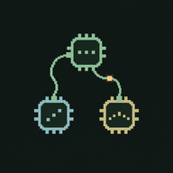

# SIGNAL MACHINES

A tiny modular playground for sound, chance and happy accidents.

Connect little machines. Make strange sounds. See what happens.

61 modules, 37 starting patches, snapshots and stereo WAV / AIFF recording. Runs in your browser. No account or backend needed.

An old-computer face for a living sound circuit: green text, small pixel windows and a handful of signal colors.

## Play

- Pick a preset and press **▶**.
- Tap a chip to edit. Use the header trash button, then **Remove**, to delete it. **+** adds another, grouped by kind.
- Tap an output, then an input to connect them.
- Draw a motion path in TOUCH, or let PENDULUM swing.
- Try a few changes. Save a snapshot. Keep wandering.

[New sound studies](https://petandb-bot.github.io/signal-machines-v1/listening/): dissolving attacks and a slipping contact voice. [Notes](docs/STRANGE_SOUNDS.md).

Headphones are useful. On a phone in portrait, FIT shows the whole rack as an overview; use + or pinch to zoom in and drag the background to pan. Landscape offers more room for patching.

FOUND explores browser-local samples with two controls; LEVEL brings quiet details forward. [Sample limits, storage and review notes](docs/FOUND_LEVEL.md).

## Run locally

Node.js 22.12+ or 24:

```sh
npm ci
npm run dev
```

Open the localhost URL Vite prints. Audio needs a tap and HTTPS or localhost.

## Share it

Push this folder to GitHub, then choose **Settings → Pages → Source → GitHub Actions**. The included workflow tests, builds and publishes the app on pushes to `main`. You can also run it manually from Actions.

```sh
npm test
npm run build
npm run verify:build
```

Pull requests run tests, build and AudioWorklet verification without deploying. The build is in `dist/`. [GitHub setup](docs/GITHUB.md) · [Full guide](docs/GUIDE.md) · [Verification](VERIFICATION.md)

MIT licensed. [Third-party notices](THIRD_PARTY_NOTICES.md)
