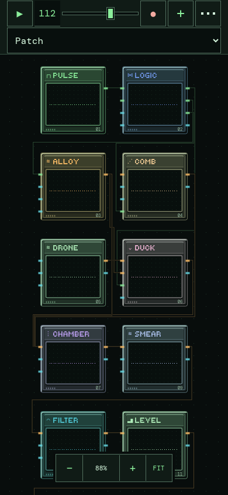
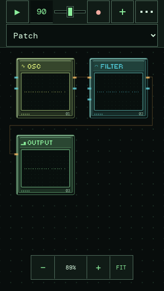
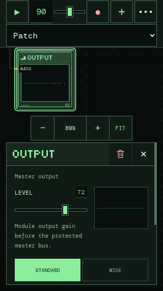

# Phone portrait layout · v0.17.6

Portrait uses a separate two-column view of the patch. It does not squeeze a wide rack into a short stage. The workspace background now fills the entire area between the header and the screen bottom.

## Before / after

SPLIT ORBITS, 402×874, Chromium 156:

| v0.17.5 | v0.17.6 |
| --- | --- |
|  |  |

The previous `--portrait-stage-height` capped the dotted workspace at 269px. FIT then scaled the original five-column patch to 43%. The new display coordinates produce two columns/four rows at 99%, with the full 781px workspace available. The source rack coordinates and connections are identical.

| Viewport | SPLIT ORBITS FIT before → after |
| --- | --- |
| 390×844 | 41.8% → 94.7% |
| 402×874 | 43.2% → 99.0% |
| 320×568 | 33.8% → 87.5% |
| 844×390 | unchanged |
| 1280×800 | unchanged |

## Display coordinates, not saved coordinates

`PortraitLayout.ts` derives a deterministic signal-flow order, ignoring held control edges for ordering. Neighbouring signals inform each row's column assignment. Workspace keeps these positions separately from `patch.modules[].x/y`. Cards, cable endpoints, cable previews, jack hit targets, dragging and editor reveal all use the same display-space lookup. Folded cables use the gaps between rows and columns.

Portrait dragging and **Arrange chips** affect only the temporary view. They do not change JSON or snapshot coordinates. Rotate to landscape to restore the original saved rack; return to portrait to resume its local view. Recalling/importing another patch rebuilds the portrait view. Adding/removing chips preserves surviving positions, and rewiring or Safari-like height changes do not reshuffle a live rack.

FIT uses the two-column bounds, a 20px top margin and the zoom-dock reserve. Scale stays between 87.5% and 100%. Eight chips fit as four rows on the larger phones. When a short screen or large patch cannot fit at a readable size, rows extend beyond the viewport: pan to reach them or zoom out for an overview. Manual zoom retains the existing continuous range; zoom buttons and pinch never snap back to the FIT minimum.

## Controls

The header has two exact 44px rows, 16px preset text, no container scaling/filter and the existing safe-area padding. The menu's three pixel dots are absolutely centered, avoiding separate grid placement of its invisible text and pseudo-element. Slider glow remains suppressed in portrait; signal colors and module animations are unchanged.

The continuous full-height workspace has a centered 200×48px dock with three 44×44px buttons. Home-indicator padding is respected, and text selection/callouts are disabled. When an editor opens, measured overlap moves the dock above it and the selected chip is revealed above the dock. A short-screen regression covers the 320×568 editor case.

| 12-module patch · pan for later rows | Three-module patch | Selected OUTPUT above editor · 320×568 |
| --- | --- | --- |
|  |  |  |

## Verification

Before/after screenshots were captured for SPLIT ORBITS (8 modules), a 12-module effects chain and a three-module patch at **390×844, 402×874, 320×568, 844×390 and 1280×800**. All six landscape/desktop comparisons are pixel-identical after paint settles. The extra fixtures are in `tests/fixtures/portrait-complex.json` and `portrait-small.json` for manual JSON loading.

Actual Chromium input tests cover pan, pinch, edit, drag, cable/jack alignment and orientation in all 15 cases. Six additional cases create a new cable by tapping real jacks and verify unchanged saved module coordinates. Three more pan to a later OUTPUT and verify editor/dock visibility. Emulated safe-area insets (47px top / 34px bottom) preserve header padding and dock clearance; the menu dots measure exactly centered.

514 tests, build and production-Worklet verification pass. The emitted AudioWorklet is byte-identical to the previous release. DSP, module parameters, graph constraints, recording, exports and animation algorithms are unchanged.

This is Chromium viewport/touch emulation, **not physical iPhone Safari**. Native WebKit font rendering, device browser-chrome transitions and touch feel remain unverified.
