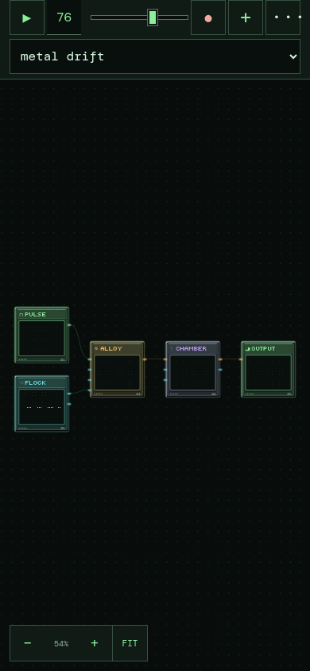
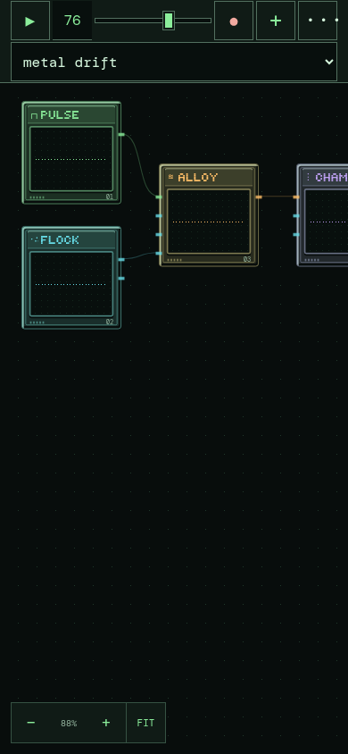

# Portrait workspace

Phone portrait views (CSS viewport ≤600px wide) prioritize readable chips and the first row. Initial view, preset changes and FIT use a minimum scale of 87.5% and a 20px top gap inside the workspace. A wide patch starts at its first top-row module; pan to reach the rest. Small patches retain their normal maximum FIT scale of 100%. Manual pinch, wheel and zoom buttons still span 25–250%, so a full overview remains available.

The header uses two exact 44px rows, a 2px row gap and 1px top/bottom padding, plus the existing safe-area inset. It measures 93px without a notch inset, down from 100px. Tap targets stay at least 44px. Preset text stays 16px, controls have flat clearer outlines, and portrait header shadows/filters are explicitly disabled. The prior header had no strong blur/glow filter; this change addresses fractional row sizing, text size and boundary contrast rather than adding sharpening effects.

Crossing between portrait and the existing wide layout refits the view. Ordinary height changes within portrait preserve the viewed top edge, avoiding a vertical jump when browser chrome changes. Module positions, jack anchors, canvas animation and patch data are unchanged. Landscape/desktop use the existing FIT calculation and styles.

| Before · 390×844 | After · 390×844 |
| --- | --- |
|  |  |

Chromium 156 headless comparison, default METAL DRIFT, no safe-area inset:

| Viewport | Header before → after | FIT before → after | First-row gap before → after |
| --- | --- | --- | --- |
| 320×568 | 100 → 93px | 44% → 87.5% | 164 → 20px |
| 390×844 | 100 → 93px | 54% → 87.5% | 286 → 20px |
| 430×932 | 100 → 93px | 59.7% → 87.5% | 320 → 20px |
| 844×390 | 50px unchanged | 91.1% unchanged | 24.2px unchanged |
| 1280×800 | 56px unchanged | 100% unchanged | 212px unchanged |

Landscape and desktop screenshots are pixel-identical before/after. Portrait checks include a larger patch, orientation changes, confirmation fit, Cancel/Remove, and native emulated touch pan, pinch, module drag and tap-to-patch. New unit tests cover FIT size/anchor, unchanged patch coordinates, horizontal safe padding, manual overview zoom, legacy wide-layout fits and resize behavior.

These are Chromium viewport/touch-emulation results. Physical iPhone/Safari rendering, font rasterization, notch/browser-chrome behavior and touch feel remain unverified.
