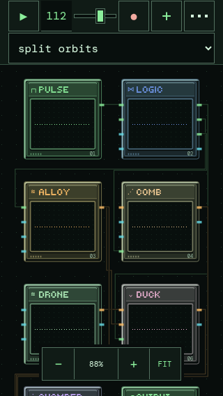
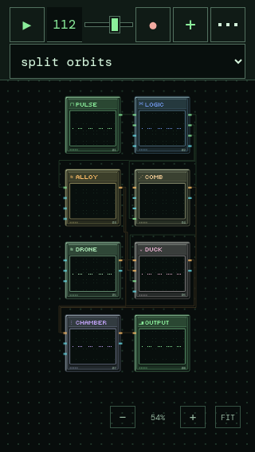
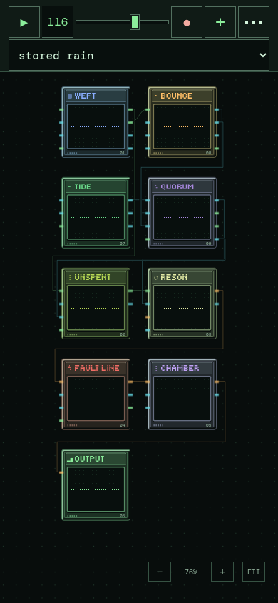

# Portrait overview · v0.17.7

Initial view and FIT now prioritize the **whole patch**, including the last row. The 87.5% floor introduced in v0.17.6 is removed. The existing two-column display coordinates remain separate from saved x/y. Zoom in manually after opening a patch.

An overview automatically refits if available height shrinks; manual zoom, pan and editor navigation are preserved instead. Height changes never reorder chips. The header sits 8px lower (safe-area inset + 9px), retaining 44px controls and 16px preset text.

The secondary zoom dock moves to the bottom-right. It has no large container frame/fill, muted text and 32×28px visible button outlines inside unchanged 44×44px touch targets. Its overall width decreases from 200 to 176px; FIT reserves space above it so chips do not overlap the controls.

| Before · 320×568 | After · 320×568 |
| --- | --- |
|  |  |

Browser verification covers SPLIT ORBITS, STORED RAIN and a three-module patch at 390×844, 402×874, 320×568, 844×390 and 1280×800. Initial chip rectangles must be inside the viewport and above the zoom dock. Landscape and desktop images match before/after exactly for all three patches. The header, dock, editing, pan, pinch, dragging, cable alignment and rotation are checked in Chromium 156 viewport/touch emulation. Physical iPhone/Safari remains unverified.

No DSP, AudioWorklet, module parameters, patch serialization or landscape/desktop styling changes.
