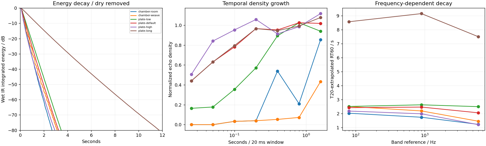
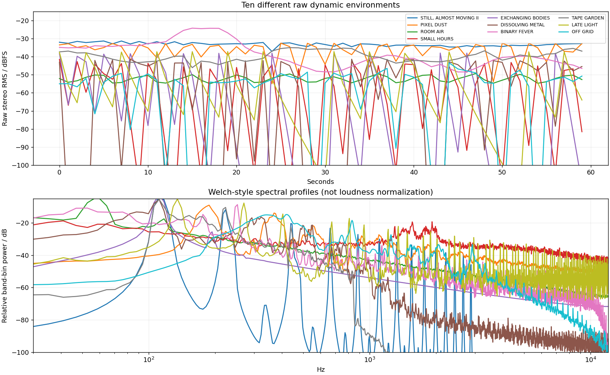

# Phase4 / PLATE & ten environments

Review candidate **v0.20.0-rc.1**, based on public v0.19.0 main `8f09add`. No merge, tag, Pages publication or other branch update. Existing audio sources, effects, graph/recording code, patch format, workspace layout and touch algorithms are unchanged.

## PLATE

An independent eight-path Householder tank with normalized lattice diffusion before and inside the feedback network. Unequal fixed paths grow a dense tail without moving delay heads, injected noise, saturation or output compression. BODY changes scattering and two feedback shelves; DECAY sets nominal midband time. Fixed direct/wet balance preserves the original attack. Channels excite/observe orthogonal spatial patterns; mono input produces a diffuse stereo tail while the direct stereo image remains intact.

[DSP design/audit](DESIGN.md), [measurements](plate-analysis.json), [source comparison](plate-comparison.json), [performance](performance.json).



| Wet-only 24kHz IR | Echo density at200ms | T20-extrapolated RT60 |
|---|---:|---:|
| CHAMBER ROOM | .04 |1.69s |
| CHAMBER WEAVE | .04 |2.09s |
| PLATE / low BODY | .57 |2.50s |
| PLATE / default | .97 |2.18s |
| PLATE / high BODY |1.06 |1.70s |
| PLATE / long DECAY | .97 |8.03s |

Default PLATE density grows .44→.63→.78→.97 at25/50/100/200ms. Similar overall decay to WEAVE but much earlier dense reflections establishes a separate numerical role. High BODY changes more than cutoff: scattering becomes denser and high-band decay shortens (measured low/mid/high RT60≈2.18/1.99/1.21s). T20 is a regression over −5 to −25dB of wet-only integrated energy, extrapolated to −60dB; fit quality and finite-window/quantization limits are retained. These are not listening scores or exact physical plate calibration.

Four PLATE voices at48kHz/128frames: mean .153ms, p95 .243ms, p99 .371ms, max3.348ms on the shared Xeon host. Maxima exceed the2.667ms interval; this is not an iPhone realtime guarantee. Fixed typed buffers are104,111 bytes per voice versus922,227 for CHAMBER. No buffer growth in30s stress. JS heap, renderer and browser memory are not included.

## The ten visible patches

Each has a standalone JSON under [`presets/curated`](../../presets/curated). Builds additionally serve `presets/curated/<id>.json` and `index.json`. Existing Save JSON remains available. No new selection panels/categories.

| Patch | World | Three useful controls |
|---|---|---|
| STILL, ALMOST MOVING II | A quiet mass of harmonics changes from within. | DRONE COLOR / PARTIAL WARP / TIDE RANGE |
| PIXEL DUST | Two swings scatter dry, stepped notes. | CHIP CHARACTER / TUNE / PENDULUM ENERGY |
| ROOM AIR | Small changes in an apparently empty room. | FOUND WANDER / ALTER / ORBIT DEPTH |
| SMALL HOURS | Rain gestures return between long pauses. | CUTS CHANGE / SPARSE / LOSS DAMAGE |
| EXCHANGING BODIES | A strike travels through connected materials. | SYMPATHY BODY / COUPLE / PULSE IRREGULAR |
| DISSOLVING METAL | Metal outlines lose their edges and hear their traces. | ALLOY TENSION / SMEAR SMEAR / PARASITE FEED |
| BINARY FEVER | Rough numbers collide in a digital circuit. | COUNT STEP / MAP TABLE / FERAL CHAOS |
| TAPE GARDEN | A steady tone grows uneven memories. | TAPE WEAR / ECHO / SIEVE FOCUS |
| LATE LIGHT | Sparse bright notes dissolve into a dark, dense tail. | PLATE BODY / DECAY / CHIP CHARACTER |
| OFF GRID | Uneven syllables move through an unfamiliar scale. | WEFT FILL / QUANTIZE SPAN / FORMANT VOWEL |

STILL uses two LIVING sources in seven modules rather than the archived nineteen-module circuit. PIXEL DUST reduces to three modules and keeps CHIP unprocessed. EXCHANGING BODIES, DISSOLVING METAL and BINARY FEVER retain successful existing structures. ROOM AIR and SMALL HOURS use the existing licensed original synthetic room/rain samples, not new field recordings. SMALL HOURS was refined after its first recording: increase spacing and shorten echoes to restore approximately55% quiet20ms windows. OFF GRID has a19-TET quantizer and asymmetric twelve-step timing. PLATE appears only in LATE LIGHT; dry and short-event worlds remain.

All ten were rendered for60s; STILL / SMALL HOURS / LATE LIGHT also for180s. Every graph has nonzero finite protected audio and zero graph faults. Raw60s RMS spans .00254–.02256, intentionally preserving quietness rather than normalizing the app presets. Peak remains below .125. Quiet fraction, energy-rise density heuristic, stereo correlation, per-second dynamics, spectral distribution and CPU/memory measurements are in [preset-measurements.json](preset-measurements.json) and [preset-spectra.json](preset-spectra.json). Thirty low/high slider comparisons verify distinct outputs; OFF GRID FILL=0 deliberately produces silence.



## Compatibility and implementation

`PRESETS` now aliases an explicit ten-entry immutable registry in `src/state/curatedPresets.ts`. Stable IDs drive the existing selector. All historical generator exports and the full42-entry `LEGACY_PRESETS` registry remain in `presets.ts`. Every old top-level JSON is untouched. `StateStore` selects PIXEL DUST only when no valid browser patch exists; saved user patches take priority, including archived patches and local sample references. No storage reset/migration or snapshot changes.

The v0.19.0 PCM reference was captured before curation. [legacy-v019.json](legacy-v019.json) stores3s stereo hashes for all42 presets at both44.1/48kHz, plus hashes of every old DSP module and top-level JSON. `check-v019-compat.mjs` verifies these exact streams and files. The production worklet verifier retains its old fixtures and LOOP/master-recording tests, then additionally verifies all ten new patches at44.1/48kHz. Old source/sample renderers explicitly use the archived registry instead of silently losing coverage after selector reduction.

Main changes: `Plate.ts`; graph definitions/types/catalog; compiler registration; one palette entry and PLATE-only pixel drawing; `curatedPresets.ts` and ten JSONs; startup/selector lookup; focused tests and offline verification/render/packaging scripts. No old DSP was edited. PLATE and curation are separate commits.

## Validation and review

- `npm ci` completed using a writable temporary cache; dependencies unchanged.
- `npm test`: **48 files /597 tests passed**. Includes silence, impulses, rates24/44.1/48, extreme/invalid inputs, continuous macros,40s release, fixed buffers, stereo/mono behavior, amplitude ratios, graph/save/restore and archive hashes.
- `npm run build`: passed. Existing bundle-size/dependency-comment warnings remain.
- `npm run verify:build`: passed; legacy worklet fixtures/recording preserved, exact42-preset PCM at both output rates, and all ten new environments in the emitted worklet at44.1/48kHz.
- UI defaults in old interaction/FIT tests now load their archived METAL DRIFT fixture explicitly. New tests separately check the curated startup, saved-user priority, stable selector IDs, ten choices, standalone JSON and PLATE save/restore. Tests no longer select presets by numeric array position.
- Chromium at390×844,402×874,320×568,844×390,1280×800: all ten patches fit without chip clipping or page overflow. Real emulated-touch hit testing opened PLATE; Cancel retained it and Remove deleted it. Workspace/CSS are unchanged. [Browser evidence](browser.json), [portrait](screens/late-light-portrait.png), [small portrait](screens/still-small-portrait.png), [desktop](screens/pixel-desktop.png).
- Self-review checked orthogonal lattice/scattering math, strict loop attenuation, fixed allocation, unchanged DSP/JSON hashes, generated public assets and source archive, and both legacy/new verification paths.

Unverified: human listening/music quality, physical iPhone Safari, mobile realtime deadlines and long-term multi-device browser behavior. The fixed tank can retain some artificial/metallic coloration, particularly at low BODY; this is an intentional option, not evidence of a smooth analogue plate emulation. Listening review of RAW and matched audio remains necessary before merging or releasing.

## Comparison artifacts and reproduction

The PR CI produces two artifacts: **phase4-plate-comparisons** (84 source/IR/raw/matched WAVs plus `phase4-plate.html`) and **phase4-ten-environments** (ten60s RAW/MATCHED pairs, three180s RAW files, standalone patches and `phase4-presets.html`). Extract and serve each root over HTTP, e.g. `python3 -m http.server`, then open the matching HTML. No Pages deployment. WAVs are generated PCM24 stereo at24kHz, not committed audio binaries. Matching uses one constant gain toward .035 RMS, capped at .8 peak; gains remain in the reports. This comparison gain is never applied in the app.

```sh
npm ci
npm test
npm run build
npm run verify:build
npm run render:phase4
node scripts/measure-plate.mjs
# Optional plotting: Python with numpy/matplotlib
python3 scripts/analyze-plate.py
python3 scripts/analyze-curated-presets.py
```
