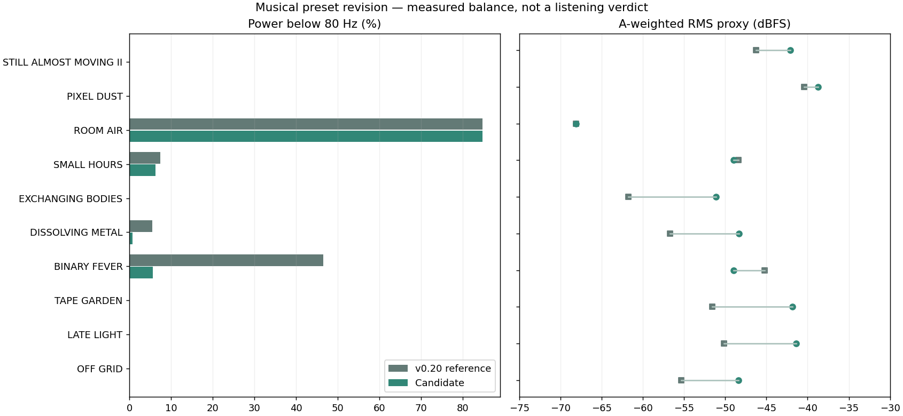
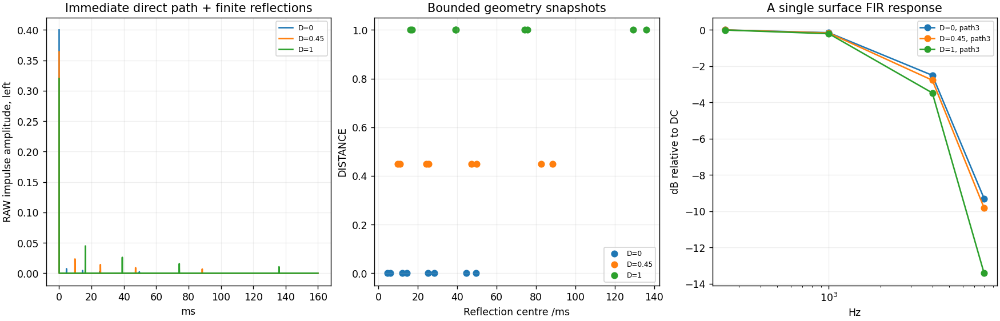
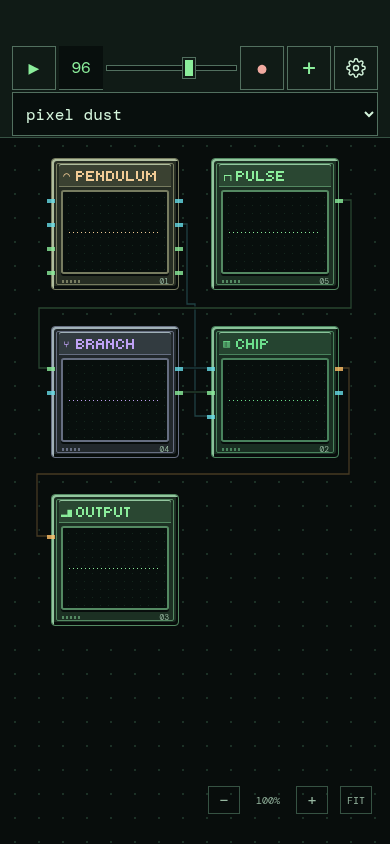
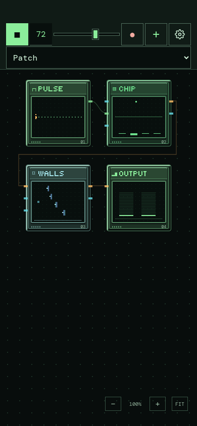
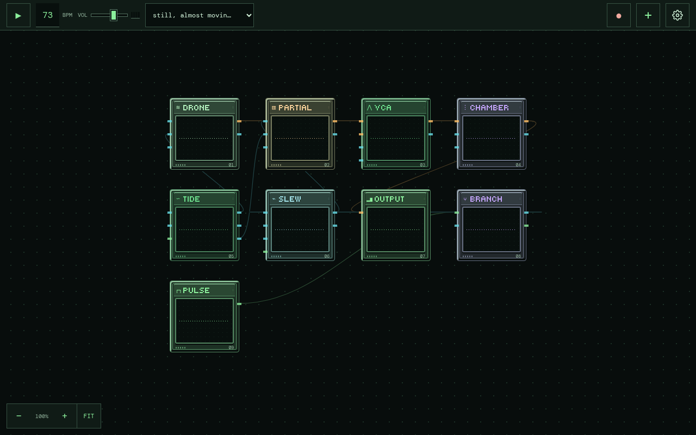

# Phase 5 — WALLS and musical starting worlds

Review candidate based on v0.20.0 (`e93ac301a2403000a861d86d0a482611ff2ac34b`). No merge, tag or Pages deployment is performed by this work.

## Musical direction

The follow-up request asks for melody, beat and quiet harmony across the ten presets. This expands the original conservative balancing scope: nine candidates now arrange existing clocks/sequencers and articulation controls to establish phrases and tonal relationships. No old DSP is retuned globally. ROOM AIR is excluded from structural changes by the user's explicit decision. Names, selector order and the PIXEL DUST startup identity remain the same.

Seven initial eight-note contours use the shipping BRANCH/CHANCE algorithms and deterministic seeds, chosen for a return to the starting note and minor-pentatonic relationships. They are not new sequencer data or a new editor. BRANCH can develop after its first cycle; CHANCE with full recall repeats its remembered phrase. OFF GRID retains 19-TET and asymmetric timing rather than being forced into the same tonal vocabulary. SMALL HOURS supplies restrained sample rhythm; ROOM AIR remains a nonmetrical breathing space. Harmonic relationships include the sustained A pedal/upper line in STILL and overlapping related note tails in LATE LIGHT, rather than a new chord instrument.

| Patch | Musical change | Tradeoff |
|---|---|---|
| STILL, ALMOST MOVING II | A slow repeated upper phrase moves above the A pedal instead of continuously wandering pitch. | The harmonic contour is more defined and the upper layer more present; free wandering is reduced. |
| PIXEL DUST | A recurring eighth-note pentatonic phrase gives the dry CHIP an immediate musical anchor. Pendulum still shapes its colour. | Five modules replace the original three-module configuration; physical motion no longer directly sweeps pitch/timing. CHIP DSP stays unchanged. |
| SMALL HOURS | A restrained seven-in-sixteen trigger pattern gives sample gestures a repeatable temporal shape without filling every gap. | External clock takes over CUTS timing; silence remains central and the SPARSE knob becomes a cooldown control. |
| EXCHANGING BODIES | A remembered upper-register bell phrase exposes both notes and body-to-body exchange. | The original single low strike becomes a pitch motif; zero-random-recall mode is stable until the user lowers RECALL. |
| DISSOLVING METAL | Repeatable pitched metal attacks remain identifiable before dissolving into their traces. | Less timing disorder and less attack smearing; the parasitic timbral feedback and metal source remain. |
| BINARY FEVER | An enveloped oscillator clocks the binary circuit into a syncopated pitched line. The driven FERAL setting avoids a continuously dominant low chaotic attractor. | Ten modules, more metrical structure and less autonomous chaos; COUNT RATE is overridden by its patched audio clock. Digital mapping and nonlinear filtering remain. |
| TAPE GARDEN | A slow upper-register phrase and approximately eighth-note tape returns make the memory audible as a musical relationship. | Less sub-register weight and gentler wear; the delay is near the tempo subdivision but retains flutter and is not hard-synced. |
| LATE LIGHT | A bright repeating note contour remains clear while its harmonically related PLATE tails overlap. | Higher CHIP register, more frequent notes and a shorter/brighter tail; still the only curated PLATE environment. |
| OFF GRID | Longer vowel notes and a retained narrower phrase make the asymmetric19-TET rhythm easier to follow. | Longer articulation reduces the old90% quiet fraction; the12-step clock and19-TET character are preserved, but fewer gates are omitted (53 →62 note triggers per60s). |

[Exact old/new parameters, connections and seed phrases](musical-plan.json) and [three controls to explore per patch](preset-guide.json) provide the complete curation record. Added connection IDs are deterministic, so the offline arranger can reproduce the JSON. The original ten JSON files are retained under [baseline/presets](baseline/presets); the older 42-patch collection is untouched.

## Measured balance

All ten references and candidates render for 60 seconds; ROOM AIR, OFF GRID, SMALL HOURS and STILL also render for 180 seconds. Reference captures were made before WALLS/curation edits. Their original JSON, 67 DSP source hashes and 14 pre-WAV Float32 PCM hashes are independently retained in [baseline/manifest.json](baseline/manifest.json). `--baseline` checks those hashes instead of overwriting the reference. Historical Phase 4 documents and measurements remain unchanged.

| Patch | Power <80 Hz, old → new | A-weighted RMS proxy, old → new | Quiet windows, old → new |
|---|---:|---:|---:|
| still-almost-moving-ii | 0.0% → 0.0% | 0.004857 → 0.007843 | 0.0% → 0.0% |
| pixel-dust | 0.0% → 0.0% | 0.009542 → 0.011599 | 5.4% → 0.0% |
| room-air | 84.8% → 84.8% | 0.000394 → 0.000394 | 0.0% → 0.0% |
| small-hours | 7.4% → 6.2% | 0.003803 → 0.003557 | 54.8% → 60.0% |
| exchanging-bodies | 0.1% → 0.0% | 0.000816 → 0.002773 | 61.9% → 59.0% |
| dissolving-metal | 5.4% → 0.7% | 0.001465 → 0.003819 | 70.6% → 41.2% |
| binary-fever | 46.5% → 5.6% | 0.005466 → 0.003561 | 0.0% → 32.3% |
| tape-garden | 0.0% → 0.0% | 0.002644 → 0.008066 | 0.0% → 0.0% |
| late-light | 0.1% → 0.0% | 0.003109 → 0.008523 | 18.0% → 6.8% |
| off-grid | 0.0% → 0.0% | 0.001711 → 0.003807 | 89.7% → 53.7% |



[Full/active RMS, peaks, DC, mono fold, event timestamps and timelines](candidate-measurements.json), [band energy/centroid](candidate-spectra.json) and [combined before/after metrics](balance-summary.json) separate measurements from musical interpretation. Quiet means a 20ms stereo RMS window below 1e-4. A-weighted RMS and 120–8000Hz RMS are spectral proxies, **not LUFS**, listening scores or phone-speaker certification. Spectra sum channel power, preserving side energy instead of analyzing only the mono fold. Sample peaks are measured; true peak is not.

This is not blanket loudness normalization: different master/output levels and rests remain. PIXEL's output was lowered from .68 to .40 after the denser/brighter phrase raised its weighted level. BINARY's low-frequency fraction falls strongly, though its weighted level also falls; A/B listening is needed to choose the final balance. ROOM AIR remains much quieter in the weighted proxy. OFF GRID's WEFT clock settings and connections are unchanged. Lower BRANCH CHANGE also reduces gate omissions, so actual SHAPE triggers rise53→62 per60s despite the unchanged clock rate. Longer articulation and fewer omissions jointly lower quiet windows from about90% to54%; this is an explicit musical tradeoff, not a level-only correction. SMALL HOURS still has about60% quiet windows.

### ROOM AIR decision

The menu's five-module ROOM AIR is byte-identical to the reference, including its approximately85% power below80Hz. As explicitly requested, [ROOM AIR / LOW CUT STUDY](../../presets/studies/room-air-low-cut.json) is a separate optional six-module JSON. It adds only the existing HIGH FILTER, approximately60Hz with no resonance, before ORBIT. This reduces the below80Hz fraction to about62%, not to zero. The source, timing, existing gains and spatial chain are unchanged; no makeup gain is added. It loses low room weight and changes phase near cutoff, while the higher air can still be quiet. It is not substituted in the ten-preset selector. [Proposal measurements](room-proposal.json).

## WALLS

One new two-control module, 68 total. AUDIO/DISTANCE/MOTION inputs; stereo AUDIO and ACTIVITY outputs. DISTANCE changes path distribution, arrival time, surface brightness and direct/reflected ratio. MOTION schedules occasional seeded changes to individual paths. Zero freezes autonomous geometry; existing transitions finish smoothly, and DISTANCE automation remains available.

Four paths per output channel read input-only stereo histories. Reflections never recirculate. Each path crossfades between stationary taps instead of continuously sweeping a delay head. A positive finite FIR models surface damping; there is no tank, generated noise, saturation, limiter or hidden normalization. Direct stereo audio has zero additional latency and gain .8–1. Tap mixtures and complementary crossfades are bounded: output is at most1.4704× the sanitized maximum input; input clamps at8 for invalid/extreme graph values. Stereo width uses mostly same-channel positive reflection mixes, without polarity widening.

At DISTANCE0/.45/1, measured first arrivals are4.46/9.71/16.13ms and last nonzero samples49.71/88.54/136ms. Reflected/direct energy rises .000895/.008312/.03339. No impulse response persists after165ms. This is a sparse early-reflection role, distinct from existing ROOM/WEAVE/PLATE feedback tails. Stationary-tap overlap can produce interference coloration; it is not a physically calibrated room or phase-transparent effect. Pixel paths and energy meters use actual DSP telemetry. The old module dimensions, jack layout rules, interactions and motion preferences stay unchanged.

[Design and existing spatial-engine audit](DESIGN.md), [comparison measurements](walls-comparisons.json), [actual geometry](walls-geometry.json), [spectrum/motion analysis](walls-analysis.json).



Standalone [NEAR OBJECT](../../presets/studies/near-object.json) and [DISTANT MATERIAL](../../presets/studies/distant-material.json) remain outside the ten-preset menu. Both render nonzero protected audio and run in the emitted AudioWorklet at44.1/48kHz.

## Reproduce and compare

```sh
npm ci
npm test
npm run build
npm run verify:build
npm run render:phase5
```

The final command generates **163 stereo PCM24 WAVs at24kHz**:108 source/spatial/impulse comparisons,4 study versions,24 immutable reference versions,24 candidate versions,3 optional ROOM versions. Comparison rate is documented to control download size; realtime checks separately cover44.1/48kHz. Open `public/listening/phase5-walls.html` or `phase5-presets.html` after rendering. Pages use relative audio paths and inline logic; they also work after extracting CI artifacts without a server. Source WAVs are generated/ignored, not committed.

WALLS comparisons use identical CHIP, metal, pulse, CUTS, DRONE, filtered noise and stereo inputs through DRY, ORBIT, ROOM, WEAVE, PLATE, static WALLS and moving WALLS. Each processor has RAW and one constant-gain MATCHED version. Active-window matching targets .03RMS with a .8 sample-peak ceiling. The two standalone studies use full-duration RMS matching instead; this distinction is recorded. Gains are stored in the reports and never applied to the app patches. Stereo field and decay differences remain, so matching does not establish perceived equivalence.

PR CI preserves legacy worklet/LIVING/SYMPATHY/architecture checks and uploads `phase5-walls-comparisons` and `phase5-musical-presets`. These are review artifacts, not a Pages deployment. Download/extract each artifact and open its HTML page.

Optional local analysis requires NumPy/Matplotlib:

```sh
python3 scripts/analyze-preset-balance.py v020
python3 scripts/analyze-preset-balance.py candidate
python3 scripts/analyze-phase5-summary.py
```

## Performance and verification

The 128-frame1/4/8-instance benchmarks run at44.1/48kHz for20 seconds per case. At48kHz eight WALLS average .713ms with p99≈1.435ms against a2.667ms interval; memory is fixed64,531 typed-array bytes per voice, with no growth. These are shared-host CPU observations, not phone guarantees. Maximum blocks exceed the interval:5.75ms at48kHz and10.97ms at44.1kHz for eight instances. A supplementary probe after6s warmup distinguishes wall time from process CPU and finds both descheduling and real CPU spikes; their JIT/GC/instrumentation causes are not fully isolated. [Complete timings](performance.json), [outlier probe](spikes.json).

Existing67 DSP source hashes, legacy patch data, recording/export/LOOP and final output protection remain unchanged. New tests cover WALLS's finite response, silent motion, static/seeded geometry, distance/CV transitions, invalid values, stereo/mono bounds, save/restore and graph operation. Curation regressions protect reference hashes, menu identity, ROOM AIR, actual sequencer phrases and OFF GRID timing.

Human listening, actual headphones/speakers, physical iPhone Safari and hardware realtime behavior are **not verified**. Musical improvement is a design intent supported by note/rhythm/spectral evidence; it still needs the user's listening review before release.

### Completed local checks

- `npm ci`:83 packages installed using an external temporary cache.
- `npm test`:50 test files,615 tests passed. After making offline arranger connection IDs deterministic,21 curation tests were rerun and passed; no audio topology or DSP changed in that follow-up.
- `npm run build`:passed, including TypeScript and the emitted worklet. The local disk could not hold a second789MB WAV copy, so generated Phase5 audio was temporarily moved out of `public` for the successful build and restored afterward. Source code and bundling were unchanged; CI renders review WAVs after building.
- Chromium156:all ten presets × five viewports390×844,402×874,320×568,844×390,1280×800, with no clipped chips or horizontal overflow. Pixel/Still/Late screenshots were inspected. Actual touch events opened the editor; cancel preserved the module and confirmation removed it. A WALLS study was imported, run and edited/deleted through the same touch UI.
- Native Chromium AudioWorklet at48kHz:1/4/8 parallel WALLS,2.5s each, finite nonzero output,49 telemetry reports per case,0 DSP faults and0 processor errors. This brief smoke test does not measure missed audio deadlines.
- Both review pages fit the390px viewport; the candidate PIXEL PCM24 WAV decoded to stereo/nonzero60s audio. No browser exceptions.

[Browser observations](browser.json). Screenshots below use emulated viewports; they are not physical phone captures.





- `npm run verify:build`:passed. Production AudioWorklet legacy fixtures,84 historical PCM streams (42×2 sample rates),LOOP/recording bridge,ten candidate presets and both WALLS studies at44.1/48kHz all passed.
