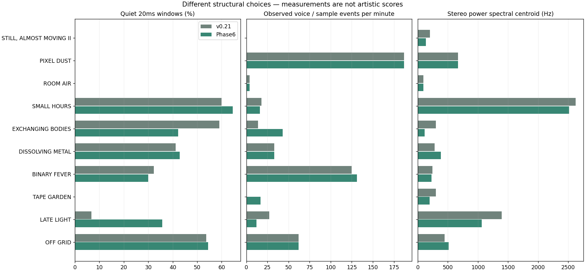
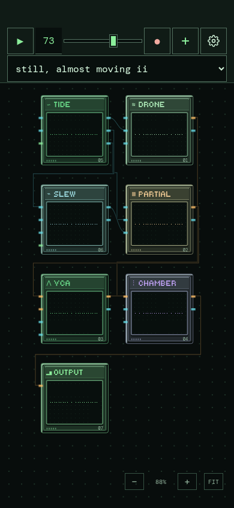
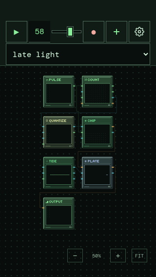

# Phase 6 — different musical languages

Review candidate from public v0.21.0, `610a6f450e88f1165732a6ced1156befaa7320cf`. **Review-only: no merge, tag or Pages deployment.**

The collection no longer relies on seven related pentatonic phrases. PIXEL deliberately keeps that accessible language; the other worlds organize sustained partials, environmental presence, irregular sample memory, interacting materials, imperfect intervals, counting, delayed fragments, overlapping decays and physical19-TET motion. Musical improvement still requires human listening.

## Architecture and compatibility

[Architecture audit and intended roles](AUDIT.md). Both BRANCH and CHANCE keep the exact old SCALE, eight-state memory, random-number consumption and gate behavior. No new mode is needed: the existing COUNT, LOGIC, QUANTIZE, TOUCH, BOUNCE, LPG and audio-memory modules supply the missing relationships at patch level. All68 audio-module source hashes match v0.21. No audio engine, signal type, parameter, storage format, snapshot behavior, recording/export code, module definition or interface layout changes.

The limitation is intentional: BRANCH/CHANCE themselves still offer the old fixed pentatonic/eight-step vocabulary. The new languages are patch constructions, available through the existing two sliders, mode controls and cables. There is no new scale editor or sequencer UI.

[Original ten JSON patches](baseline/presets), [68 DSP/JSON hashes](baseline/manifest.json) and [20 reference PCM hashes at44.1/48kHz](baseline/pcm3s.json) are independent references. Before-curation60/180/300s hashes are retained in [v021 measurements](v021-measurements.json); all fourteen overlapping Phase5 Float32 captures match exactly. Baseline regeneration checks their hashes and refuses to replace committed reference measurements. Phase4 and Phase5 documents, original42 patches and their84 historical PCM streams remain untouched.

Historical Phase4/5 renderers now read frozen collections and do not replace committed old measurements with current observations. Phase5 historical tests read the frozen v0.21 collection; current curation is tested separately. Their source-hash checks remain intact, with no exceptions or updated old hashes.

## Ten approaches

| Patch | Pitch, time and primary development | Tradeoff |
|---|---|---|
| STILL, ALMOST MOVING II | A fixed110/220Hz harmonic relationship changes partial overlap and density, without foreground note sequencing. | Two fewer modules. The upper source is quieter and nearer harmonic partials; drift/mass and slowly smoothed WARP around its harmonic center create internal development rather than a melody. |
| PIXEL DUST | The collection's intentionally familiar, dry eight-note pentatonic melody. | Preserved byte-for-byte: existing rare gate omissions, later BRANCH memory changes and PENDULUM colour already supply modest variation. |
| ROOM AIR | Original nonmetrical room presence, with a minimal +12dB LEVEL proposal. | One gain-only module; no low-cut, compression or source/timing/spatial edits. Low-frequency room weight remains. Review at matched playback levels before accepting this gain choice. |
| SMALL HOURS | Irregular autonomous fragments, sample-feature recency and returning MIRAGE memory, with no explicit beat. | One fewer module. CUTS now controls event spacing; intervals are bounded but seeded, and MIRAGE/NERVE/LOSS retain contextual memory. No fixed phrase is promised. |
| EXCHANGING BODIES | A longer ringing body and a shorter responding body interact under3:2 companion timing; the first physically excites the second. | One net additional module. No bell melody; two materials share a nominal110Hz root with slowly changing coupling. The reply is also excited by the first body between its own strikes. |
| DISSOLVING METAL | Unequal7.3s three-plateau motion and an independent strike clock produce imperfect near-unisons/fifth-like intervals. | Same module count. Approximate held targets220/329/229Hz are not a conventional scale. TOUCH transitions and existing ALLOY continuous-pitch tracking also retune overlapping tails; interference is intentional, listening still required. |
| BINARY FEVER | Seven-in-twelve articulation interacts with a three-times-longer reset pattern and an audio-rate binary divider. | One fewer module; OSC/FERAL pitch is fixed. Counter resets can change the waveform at an accent; existing MAP/filtering and bounded levels remain. Rhythm replaces melodic variety. |
| TAPE GARDEN | A two-tone tritone family becomes finite gestures; worn delayed memory supplies the returns. | Two net additional modules. Continuous upper melody is replaced by155.6/220Hz gestures, separated from approximately.484s echoes; original tape/space colour remains. |
| LATE LIGHT | Four held interval positions become related through PLATE overlap, with slower uneven arrivals and missing events. | One net additional module. The arithmetic cycle is four states, not eight notes; longer gaps retain openness. The four pitches are approximately370/440/554/311Hz, with no root-to-root phrase closure. |
| OFF GRID | Asymmetric12-step time samples moving physical coordinates onto19-TET; the second clock stream disturbs the motion. | Same module count. Held physical pitch replaces the pentatonic source. Every WEFT A event now articulates directly instead of BRANCH probabilistically omitting some; narrower span and existing long fall preserve space. |

[Every old/new parameter, seed, module and cable](changes.json) and [three useful controls per patch](preset-guide.json). Names/order/default PIXEL and all existing master/output levels are retained. PIXEL JSON and PCM remain identical. ROOM changes only by inserting the existing LEVEL at+12dB, COMP0, after CHAMBER. Its spectral character and low room weight remain; no filter is added.

STILL holds110/220Hz source centers. PARTIAL WARP is centered at.5, the existing integer-harmonic position, and slowly moved by smoothed TIDE; its constant VCA level keeps the upper layer audible. An explicit regression checks that the upper source has not accidentally been muted by a tiny bipolar control. The stillness comes from overlapping partials and unequal slow processes, not a foreground melody.

EXCHANGING uses two material settings and actual audio excitation from one body into the other. LOGIC learns its clock period on subsequent arrivals; its first few seconds can contain quicker replies while it still assumes the project beat. Later companion timing is approximately3:2, subject to the existing pulse drift. It is not an exact call/response count ratio over the whole clip.

METAL's unequal7.3s TOUCH path has held targets near220/329/229Hz, sampled by an independent jittered strike clock. Brief path transitions and existing continuous ALLOY pitch tracking affect retained tails too. TAPE alternates two targets0/−6 semitones and lets struck LPG envelopes meet worn returns; its output remains continuous above the quiet threshold because echoes overlap. LATE's four target positions−3/0/+4/−6 are connected by frequency-dependent PLATE decays and unequal arrival times. It is intentionally stable in pitch order, with no root-to-root closure; its notes are perceived through different tail contexts rather than a constantly changing sequence.

BINARY has a stable carrier and seven-in-twelve articulation against a longer reset stream, with no melodic sequence. OFF keeps the same WEFT settings and19-TET grid while moving physical coordinates replace BRANCH pitch. In the measured60s both old/new OFF have62 articulation events: its new identity does not depend on increasing density.

## Structural measurements

All ten:60s and180s. STILL, ROOM, SMALL and TAPE:300s as well. Each reference/candidate graph is rendered once to its longest duration and prefixes are analyzed/exported. No new automatic loudness processing is applied in the app.

| Patch | Voice/sample events, old → new /60s | Quiet20ms windows | RMS, old → new | Candidate peak |
|---|---:|---:|---:|---:|
| still-almost-moving-ii | 0 → 0 | 0.0% → 0.0% | 0.024485 → 0.021320 | 0.0772 |
| pixel-dust | 187 → 187 | 0.0% → 0.0% | 0.019279 → 0.019279 | 0.0654 |
| room-air | 4 → 4 | 0.0% → 0.0% | 0.002535 → 0.010091 | 0.0419 |
| small-hours | 18 → 16 | 60.0% → 64.5% | 0.003463 → 0.003250 | 0.0678 |
| exchanging-bodies | 14 → 43 | 59.0% → 42.2% | 0.006037 → 0.008131 | 0.0663 |
| dissolving-metal | 33 → 33 | 41.2% → 42.9% | 0.009142 → 0.008621 | 0.1097 |
| binary-fever | 125 → 131 | 32.3% → 30.0% | 0.009438 → 0.009478 | 0.0489 |
| tape-garden | 0 → 17 | 0.0% → 0.0% | 0.017895 → 0.007637 | 0.0605 |
| late-light | 27 → 12 | 6.8% → 35.7% | 0.009675 → 0.006564 | 0.0811 |
| off-grid | 62 → 62 | 53.7% → 54.4% | 0.006348 → 0.005662 | 0.0873 |



[Candidate observations](candidate-measurements.json) contain peak/RMS/active-window RMS, quiet fraction, stereo correlation/mono fold, stereo power spectrum, quarter-semitone pitch-class/interval histograms, event-spacing coefficient of variation, repeated four-note windows, exact observed pitch periods,10s spectral/energy timelines and sampled control ranges. Full event timestamps/control trajectories are in the generated artifact reports. The target pitch is observed at the end of the128-frame block containing an onset; it is not an acoustic pitch estimator or a complete account of retained polyphonic notes.

An exact observed period can become null after one omitted note or mutation even when BRANCH's underlying storage has eight slots. Conversely TAPE's2, LATE's4 and BINARY's1-note target periods are useful stable structures, not defects to maximize away. Unclocked STILL has no note-event series; ROOM events are FOUND region changes, not pitched notes. Event counts do not measure perceived onsets from all resonant/echo tails. Low/high spectral power is a stereo-summed Welch estimate; A-weighted Welch RMS is only a proxy, not LUFS, a phone-speaker model or the different full-file FFT method used in Phase5.

ROOM's approximately85% below80Hz power is deliberately preserved. Its+12dB gain is approximately3.981× at unchanged dynamics, confirmed by a separate gain comparison; inspect RAW and MATCHED before accepting it. SMALL's quiet fraction rises toward66% at300s. TAPE has0% quiet windows despite more strongly articulated input, illustrating why silence statistics alone do not describe musical phrasing. LATE's quiet fraction rises from about7% to36% at60s, and remains about37% at180s. These are design observations, not claims of artistic superiority.

## Listening review

```sh
npm ci
npm test
npm run build
npm run verify:build
npm run render:phase6
```

The last command produces68 stereo24kHz PCM24 WAV files. GitHub Actions uploads:

- `phase6-short-ab`:all ten60s RAW/MATCHED pairs, two players, original/candidate JSON and full analysis reports. Extract and open `phase6-short.html`.
- `phase6-long-ab`:all ten180s RAW pairs and four300s RAW pairs, original/candidate JSON. Extract and open `phase6-long.html`. Use the short artifact for level-matched comparison.

Keep the audio/ and presets/ folders beside the HTML. Pages have no external dependencies or fetch requests; serve locally with `python3 -m http.server` if local-file media is restricted. GitHub can require sign-in for artifact download; retention is14days. No large WAVs are committed and no Pages deployment is performed.

RAW is protected graph output before WAV quantization. MATCHED uses one constant offline gain toward.03 active20ms RMS, capped at.8 sample peak, and preserves spatial/temporal differences. It is not perceptual normalization. The lower bit-level quantization noise of PCM24 does not replace listening. Comparison sample rate is24kHz for download size; compatibility separately covers44.1/48kHz. The exact Float32 pre-WAV hashes are retained.

For local analysis without allocating the full WAV collection:

```sh
node scripts/render-phase6.mjs --no-audio
node scripts/measure-phase6.mjs
python3 scripts/analyze-phase6.py  # NumPy / Matplotlib
```

## Performance and checks

At44100Hz, candidate graph mean blocks range0.167–0.794ms, with worst p992.372ms against a2.902ms128-frame interval.

At48000Hz, candidate graph mean blocks range0.167–0.464ms, with worst p991.093ms against a2.667ms128-frame interval.

[Paired graph timings and memory](performance.json) use12s per graph, omit the first2s, and time only graph.process with preallocated outputs. Extra LEVEL/LOGIC/LPG and the responding SYMPATHY add real work; these are not CPU-free changes. Typed-buffer growth is zero throughout the long render matrix. JS heap, UI rendering, browser scheduling and worst-case minutes-long processor state are not certified by this short benchmark. Maximum scheduling/JIT outliers remain; there is no physical iPhone realtime guarantee. A first contended pass is retained in performance-contended.json; comparison conclusions use the later separated run.

Local `npm ci`, build/TypeScript and production worklet checks passed. Existing615 tests passed initially; a concurrent run including the new tests hit three5s timeouts in unchanged heavy tests. With the render/verification workload separated, all622 then-existing tests passed in121.77s. The final additional upper-layer regression is run separately; PR CI runs the complete final suite. No timeouts were increased or old assertions weakened. New regressions cover all68 source hashes, frozen JSON, the unchanged PIXEL, gain-only ROOM, actual two/four-state arithmetic, reproducible physical19-TET, audible upper material and real material/reset routing. Source/default BRANCH/CHANCE behavior is unchanged; legacy and frozen PCM comparisons verify it in complete patches.

Chromium156 checked all ten presets at390×844,402×874,320×568,844×390 and1280×800, with no clipped chips or horizontal overflow. Actual touch events opened the editor; removal cancellation preserved the module and confirmation removed it. Short/long review pages fit390px; both original/candidate ROOM WAVs decode to nonzero stereo60s audio, and unavailable300s choices are disabled. Representative screenshots were inspected. [Browser observations](browser.json).




**Unverified:**human listening, perceived musical improvement, physical iPhone Safari, headphones/speakers and hardware deadline behavior. The review materials are for judging these questions; algorithmic diversity does not establish musical quality. Keep the current public release until listening and code review are complete.
