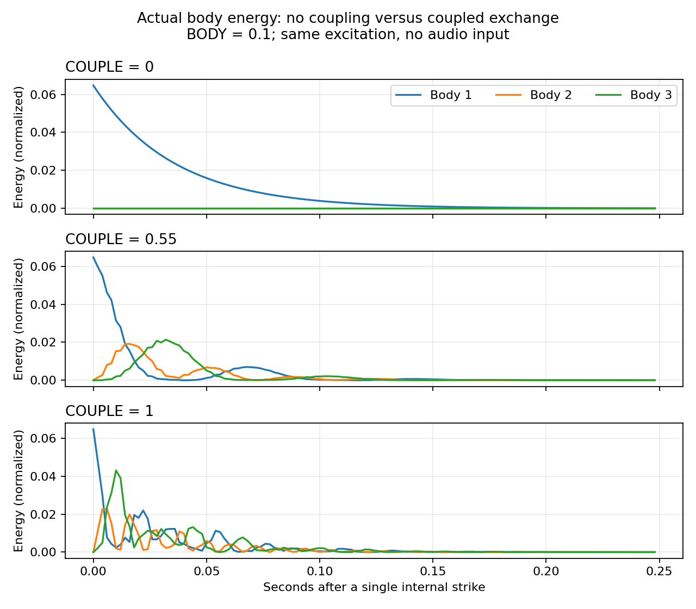

# Phase 3 — SYMPATHY review candidate

Independent main v0.18.0 / abf0634 branch. PR13/14 remain unmerged. No LIVING-mode dependency, modified original DSP, new layout, saved JSON field or preset-registry change. The library adds one machine (66 total); three independent JSON demos can be imported into this candidate build. No main merge or Pages deployment is authorized for this phase.

[Design before implementation](DESIGN.md) compares all eight requested neighboring instruments. SYMPATHY is a three-body, two-channel gyroscopic oscillator network, not a copied RESON bank, delay, reverb or fixed combination of old effects. It stores six position/momentum pairs, not captured audio.

## Why energy moves without numerical gain

Each oscillator half-step is an exact sine/cosine rotation followed by positive damping. The middle links are orthogonal momentum rotations on01/12/01. They preserve squared norm, including while coefficients change; damping decreases it. Mechanical energy is E=sum(q²+p²)/2 in normalized coordinates. No Euler integration, saturation, compression or post-step state clamp is used. BODY changes ratios and loss; COUPLE changes exchange rate. At zero, link rotations are exactly identity. Only body0 receives excitation, so later energy in bodies1/2 establishes exchange, not additional drivers or a louder mixer.

Input and finite mallet power can supply energy. AUDIO is guarded at the same±8 numeric scale as graph signals; ordinary audio is linear. Its force coefficient is1.8×(1−exp(−gamma/sampleRate)), split equally around the passive update. Combined with minimum damping this bounds normalized state norm by the input's peak, rather than allowing arbitrary resonant amplification. Internal TRIG admits at most the remaining .36 squared-norm budget, with20ms recovery. This limits incoming mallet work; it never compresses or removes existing resonant energy. Quiet inputs remain proportional. Seed sets mallet direction; no constant noise or random LFO is present.

Fixed velocity pickups (.86/.43/.25, with the last two exchanged on the right) give each body a slightly different stereo contribution. Independent left/right networks retain channel independence. A rate-scaled3Hz output DC blocker removes stationary offsets. Sub-audible states/monitor tails are zeroed only at numerical-noise thresholds to avoid denormals; this is not audible output gating. Changing BODY/PITCH preserves normalized energy, not a literal fixed-mass spring potential: this is an imaginary instrument, not a calibrated physical simulation.

## Controls and visualization

- BODY: from close beating bodies to spaced inharmonic ratios, with material-dependent decay.
- COUPLE: from independent motion to stronger energy sharing; CV can shape the exchange.
- Inputs AUDIO / TRIG / PITCH / COUPLE; outputs AUDIO / ACTIVITY. Four existing jack positions; two sliders; no new editor or chip geometry.
- ACTIVITY reports smoothed stored-energy activity, not an RMS meter. Telemetry exposes actual body energies, signed link transfers, displacement and uncoupled frequencies. Three pixel bodies and their links respond to those states and become still at rest. Existing animations and Reduced Motion machinery are retained.

## Measured exchange and spectrum

Single internal strike, BODY=.1, no AUDIO. COUPLE0 leaves bodies1/2 exactly at zero. At .55 their peak normalized energies reach .01914/.02138; at1 they reach .02274/.04304 (see exact report). The summed unforced mechanical energy never increases. Energy returns between bodies before decaying, visible in the curves, not inferred from loudness.

For the identical2ms external pulse at BODY=.42, observed response peaks above the FFT threshold are110Hz at COUPLE0,108/147Hz at .55, and94/149/209Hz at1. The middle case's weaker third component does not cross the1% power threshold; this is not a claim of only two physical bodies. [Spectral/exchange report](spectral-exchange.json) states FFT method/limits. Listed DSP coefficient frequencies are the uncoupled frequencies; actual coupled response peaks are measured from exported audio. A finite PCM16 FFT is not proof of absence of aliasing.

[Measurements](measurements.json) retain raw peak/RMS, stereo correlation, max adjacent-sample step, final-second decay energy, constant comparison gain, observed CPU and fixed typed-buffer counts for every case. Full time-series data remain in the generated listening report rather than bloating source JSON.

## Audio and demos

`node scripts/render-sympathy.mjs` writes132 WAVs and report.json under `public/listening/audio/sympathy/`: six common inputs;54 BODY/COUPLE combinations in raw and matched forms;12 RESON/CHAMBER comparisons; three internal-strike studies; three demos. Inputs are one2ms pulse, triggered CHIP, short ALLOY metal, a110Hz sine,80–1500Hz one-pole band-limited noise and autonomous CUTS/MACHINE. BODY0/.42/1 and COUPLE0/.55/1 cover weak/default/strong responses. Matched files apply one fixed gain toward .025 RMS, capped at64× and .8 peak; raw files and actual gains are retained. No time-varying normalization/compression or manufactured noise floor.

RESON receives the same input on its EXCITE port, CHAMBER on AUDIO. Their DSP and default parameters are untouched. The source CHIP's intentional stepped-wave roughness is part of the input, not attributed to new aliasing in SYMPATHY.

- [SMALL RESONANCE](../../presets/small-resonance.json): short CHIP gestures through AUDIO-only SYMPATHY, with LEVEL to hear quiet transients.
- [EXCHANGING BODIES](../../presets/exchanging-bodies.json): sparse internal strikes; TIDE shapes pitch/exchange. No additional reverb hides the network.
- [LIVING MATERIAL](../../presets/living-material.json): CUTS feeds the body and NERVE controls additional strikes; MIRAGE retains later traces. It uses only current main modules, not Phase2 LIVING.

The PR workflow reproduces comparisons in the14-day `four-machines-listening` Actions artifact. Serve its listening root with a local HTTP server and open `sympathy.html`. No generated WAV is committed or published to Pages by this PR. Optional `python3 scripts/analyze-sympathy.py` uses NumPy/Matplotlib only offline, never in the application.

## Regression, runtime and review

`npm ci`, full `npm test` (575 tests /43 files), `npm run build` and `npm run verify:build` passed. The production worklet renders all42 old presets plus all3 new demos and retains recording/LOOP checks. Final numerical-silence monitor cleanup passed the14 dedicated DSP/demo tests and a rebuilt emitted-module check at44.1/48kHz. [Legacy PCM comparison](legacy-compat.json) matches all42 original stereo streams against an unchanged v0.18.0 source checkout for a0.501s window; it supplements longer existing tests, not proof of every possible history.

Dedicated tests cover24/44.1/48kHz, zero coupling isolation, monotonic unforced energy, quiet audio, TRIG/audio/both, extreme/invalid input, macro corners, smooth retuning, longest-tail release, DC, separate seeds/instances, JSON, snapshots and unchanged audio-cycle restrictions. Existing modules and preset JSON files are unchanged. All additional DSP arrays are fixed and no arrays/objects are allocated per sample. Telemetry uses the existing update boundary.

[Performance](performance.json): eight instances at48kHz for60s took4.04s of observed server wall time (6.73% of audio duration), with684 typed-buffer bytes per voice and no buffer growth. Mean128-frame block .179ms; p99 .457ms; maximum4.379ms. The maximum exceeds the2.667ms nominal block duration: this offline observed maximum includes scheduler/instrumentation jitter and is **not a passed hard real-time deadline test**. Physical iPhone Safari remains unverified. Across24/44.1/48kHz, comparable strike RMS and peaks agree closely; exact figures are recorded.

[Browser evidence](browser.json): real Chromium renders390×844,402×874,320×568,844×390 and1280×800; cable/jack alignment, two-slider editor, four inputs/two outputs, Run/Stop and delete/cancel passed. Real44.1kHz worklet telemetry shows nonzero body1 energy and zero faults. [Portrait patch](screens/patch-390x844.png), [small editor](screens/editor-320x568.png), [landscape editor](screens/editor-844x390.png). These are viewport emulations, not Safari/device testing.

Review checked conservation/passivity, bounded excitation, zero-coupling isolation, channel independence, body telemetry and final numerical-silence cleanup. **Human listening remains unassessed.** Different spectral/energy histories do not establish musical quality or a preferred sound. Default AUDIO impulse response can be deliberately quiet because drive is damping-normalized; LEVEL and matched comparison files make it inspectable without changing its dynamics. The existing large Vite bundle warning remains. Keep this PR unmerged until audio, character and device behavior are evaluated.
