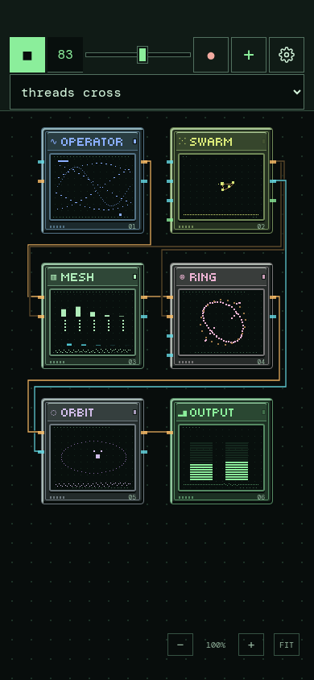
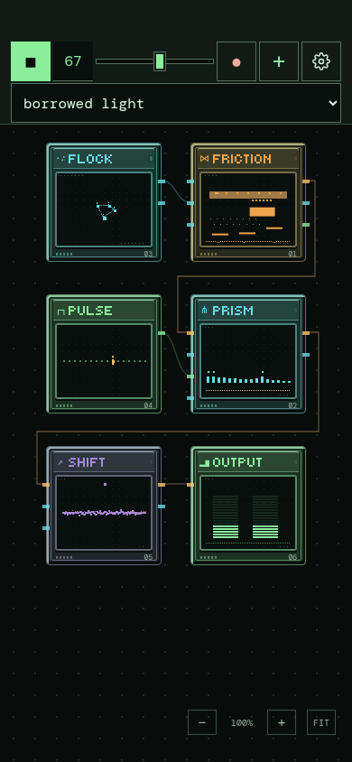

# v0.23.0 — twenty starting worlds

Ten additional presets, appended after the unchanged v0.22 collection. Base:`e2d652ba8dd79c28fe66f3c39ee42b43fe3fdabb`. The user authorizes publication after self-tests; merge and Pages deployment are gated on successful validation.

## More roles, not more engines

The original ten used39 of68 module types. These ten additions bring28 previously-unused roles into ready-to-play circuits, covering67 types in total. [Exact usage and where to try each module](usage.json). LOOP remains available in the library but is deliberately absent from self-starting presets: its recording workflow needs a player's take rather than a hidden automatic recording action.

No DSP, new modules, sliders, visual theme, patch format, cable interaction, recording/export or snapshots change. All76 existing audio-module source files and the original ten JSON files are protected by [baseline hashes](baseline.json). Original presets retain their order and settings; PIXEL DUST stays the initial patch. Saved user circuits retain priority. The app's existing selector simply offers20 choices; the library still contains68 machines.

## New worlds11–20

| Patch | Musical principle | Useful controls |
|---|---|---|
| SOFT CIRCUIT | Slow interval attraction rather than a note sequence; mild folding and short stereo motion. | carrier-1/depth, sideways-1/attraction, caustic-1/burn |
| PAPER WINDOWS | Five-in-twelve noise gestures meet a slower plucked comb; finite early reflections, no reverb tank. | weft-1/fill, comb-1/decay, walls-1/distance |
| BORROWED LIGHT | A new oscillator spectrum remembers intermittent captures; small frequency-shifted interference changes the held light. | friction-1/pressure, prism-1/memory, shift-1/shift |
| VELVET ENGINE | Five-in-eight articulation and a slower ducking cycle give one repeated tone different weights. | fuzz-1/drive, weft-1/fill, duck-1/depth |
| DEFERRED SIGNAL | Gate storage defers events, not pitches: the resonator strikes its current held pitch when the queue releases. | unspent-1/hold, unspent-1/release, reson-1/material |
| THREADS CROSS | Physical group motion shapes spectral energy, low ring-modulation depth and actual stereo position. | swarm-1/sympathy, mesh-1/transfer, ring-1/mix |
| SHATTERED CLOCK | Actual detected attacks capture fragments while accumulated stress cracks their timing; stepped output remains restrained. | fault-1/pressure, fracture-1/break, crush-1/bits |
| DISSENT IN GLASS | A held consensus steers one pitch; dissent occasionally changes the audible source with a smooth crossfade. | quorum-1/agreement, quorum-1/stubborn, switch-1/fade |
| BROKEN RADIO | No melody: a slowly moving noise band and sparse transmission interruptions form a mid-register surface. | venom-1/strain, filter-1/cutoff, snap-1/fault |
| PASSING SHADOWS | Long region changes, physically steered grain spread and occasional dry/memory switching preserve the source identity. | cloud-1/grain, cloud-1/spread, found-1/alter |

SOFT CIRCUIT uses patchable PM and coupled slow controls, rather than another note loop. PAPER WINDOWS is sparse noise/plucked resonance with finite early reflections. BORROWED LIGHT makes a held harmonic spectrum from rubbing contact. VELVET ENGINE emphasizes fuzzed articulation and displaced ducking. DEFERRED SIGNAL stores gates, not pitches: a released event strikes whatever pitch CHANCE currently holds. It is the additional remembered pitch vocabulary, not a universal template.

THREADS CROSS transfers a moving swarm's spectral energy into another oscillator and uses its physical centre for stereo position. SHATTERED CLOCK takes actual attacks back into its fragment/stress processing without adding a cyclic graph connection. DISSENT IN GLASS makes competing controls decide a held pitch and occasional source changes. BROKEN RADIO is intentionally unpitched, mid-band electrical noise with interruptions. PASSING SHADOWS switches between a synthetic machine recording and its granular history; it needs no local sample file.

Every module has a directed influence path to OUTPUT. Saved chip rectangles do not overlap. New patches use6–8 chips and keep the existing portrait reflow/FIT and desktop rack rules. No new panel or selector category is introduced.

## Audio self-check

Every new graph runs for180s at24kHz, with finite output, fixed typed-buffer storage, no graph faults and audible activity within3s. Each exports60s RAW and constant-gain MATCHED PCM24 previews. [Full metrics](measurements.json) include peak/RMS, active20ms RMS, quiet spans, longest quiet gap, stereo correlation/mono fold, spectral proxies, state events and memory. Full state trajectories are in the generated listening report.

| Patch | RMS / active RMS | Sample peak | Quiet fraction | First active second | Typed buffers |
|---|---:|---:|---:|---:|---:|
| SOFT CIRCUIT | 0.022805 / 0.022805 | 0.0395 | 0.0% | 0.00 | 18,554 bytes |
| PAPER WINDOWS | 0.001304 / 0.002749 | 0.0658 | 77.5% | 0.00 | 49,512 bytes |
| BORROWED LIGHT | 0.006454 / 0.006455 | 0.0256 | 0.0% | 0.08 | 4,635 bytes |
| VELVET ENGINE | 0.005206 / 0.008375 | 0.0381 | 61.4% | 0.00 | 3,615 bytes |
| DEFERRED SIGNAL | 0.003895 / 0.005212 | 0.0805 | 44.1% | 1.20 | 2,894 bytes |
| THREADS CROSS | 0.022049 / 0.022049 | 0.0413 | 0.0% | 0.00 | 3,239 bytes |
| SHATTERED CLOCK | 0.006612 / 0.007853 | 0.0836 | 29.1% | 0.00 | 569,303 bytes |
| DISSENT IN GLASS | 0.011739 / 0.011739 | 0.0253 | 0.0% | 0.00 | 3,844 bytes |
| BROKEN RADIO | 0.002921 / 0.003308 | 0.0315 | 22.0% | 0.24 | 3,281 bytes |
| PASSING SHADOWS | 0.003327 / 0.003327 | 0.0493 | 0.0% | 0.00 | 2,729,126 bytes |

Sparse PAPER WINDOWS is not raised merely to match sustained RMS: its attacks peak around.066 while much of its output is quiet. VELVET ENGINE and DEFERRED SIGNAL retain spaces; the unpitched radio remains a quiet surface. SOFT CIRCUIT and THREADS CROSS are steadier voices with lower output settings to avoid dominating the collection. BROKEN RADIO uses the existing LEVEL at approximately+10dB with no compression to reveal its deliberately quiet noise source. No blanket preset normalization is introduced.

MATCHED files use one fixed offline gain toward.03 active-window RMS, capped at.8 sample peak. That gain never enters the app. Spectral values use stereo-summed Welch power; they are not LUFS, acoustic pitch measurements or artistic scores. Initial self-tests caught an unconnected final audio path and an almost inaudible noise setting; both were corrected before release. This is why JSON validity alone was not considered sufficient.

## Reproduce and listen

```sh
npm ci
npm test
npm run build
npm run verify:build
npm run render:twenty
```

PR CI retains legacy worklet/LIVING/SYMPATHY/architecture checks and uploads `twenty-presets-listening`:20 preview WAVs,10 JSON patches, a report and `twenty.html`. Extract with its audio/ and presets/ folders intact. Serve the directory locally if the browser restricts local-file media. Artifact retention is14days. No large audio is committed.

All new JSON patches also work in v0.22 because they use existing types and parameters. Builds export all20 standalone patches at `presets/curated/` with a20-entry index. Historical Phase4/5/6 renderers, their measurement baselines and v0.21 PCM reference verification remain scoped to their original ten identities; expanding the app does not rewrite history or try to find non-existent historical files for new names.

New regression tests protect the ten original JSON hashes, all audio-module source hashes,20 independent identities,67-type coverage, nonoverlapping saved positions and signal reachability. All ten additions must repeat sample-identically from their saved seeds across128/193/257/64-frame quanta. Current production AudioWorklet checks exercise all20 presets at44.1/48kHz, in addition to84 legacy PCM streams,20 frozen v0.21 streams, LOOP recording and master PCM protection.

Human listening, actual headphones/speakers and physical iPhone Safari are not verified. CPU deadline guarantees are not inferred from offline rendering; typed-buffer measurements exclude JS heap. Numerical self-checks establish signal behavior and reproducibility, not artistic quality. Browser screenshots/observations and final CI/deployment status are linked in the release PR.

## Completed local validation

- `npm ci` succeeded; `npm test`:52 files,657 tests passed.
- `npm run build`:TypeScript and production bundles succeeded.
- `npm run verify:build`:production AudioWorklet,all20 presets at44.1/48kHz,legacy PCM,LOOP/master recording and frozen v0.21 comparisons passed.
- [Browser checks](browser.json):all20 presets at390×844,402×874,320×568,844×390 and1280×800, both initial presentation and explicit FIT. No chips clipped or overlapped; no horizontal page overflow. Touch editor/removal cancellation/removal worked.
- Native Chromium48kHz RUN/STOP and actual state telemetry checked for THREADS CROSS,BORROWED LIGHT,DISSENT IN GLASS,SHATTERED CLOCK:finite peaks,0 graph faults,0 browser exceptions. Four SWARM particles and16 PRISM bands reached the screen.
- Listening page fits390px; its WAV decodes as nonzero stereo60s audio.



